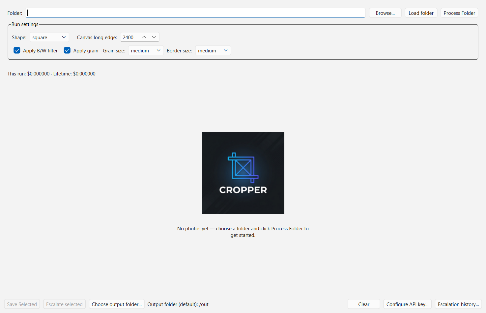
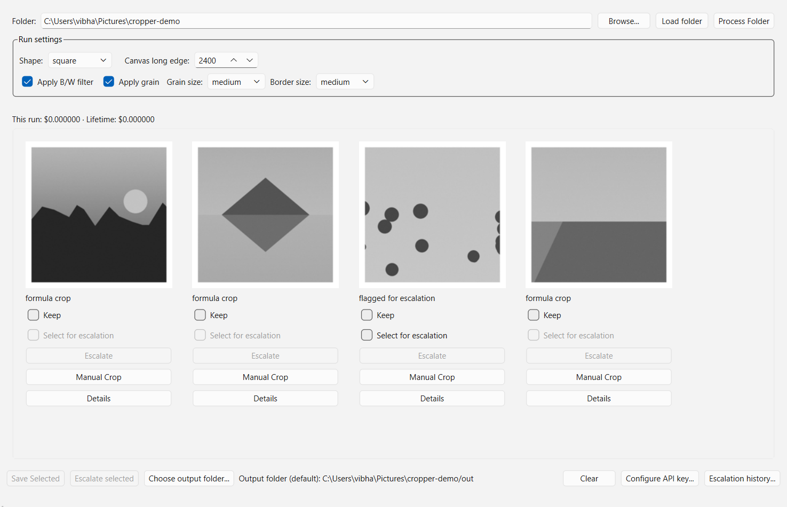
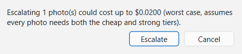
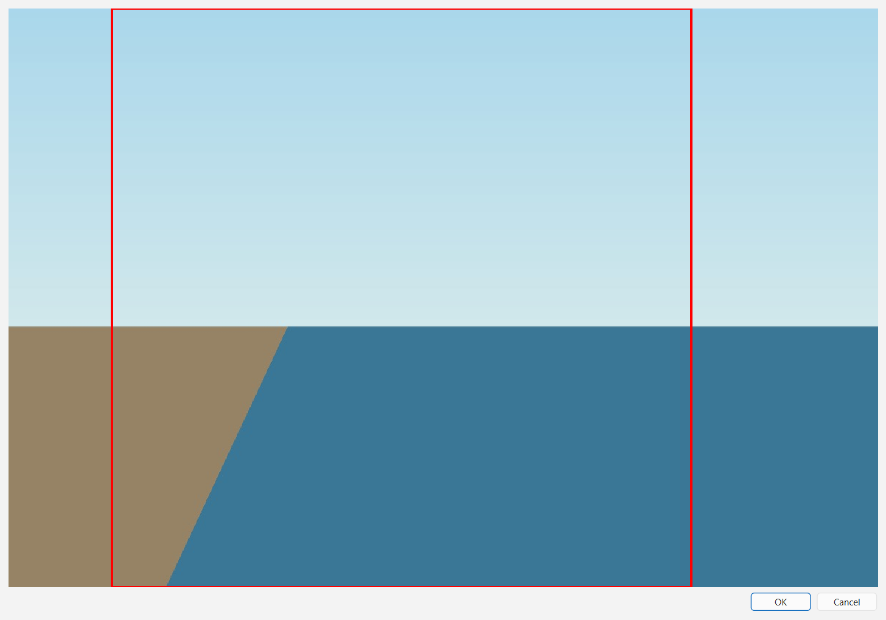

# Cropper

A desktop tool that turns a folder of travel photos into a consistent,
gallery-ready set: fixed canvas, real composition judgment, and a
black-and-white film-emulation look, without paying per-photo AI cost for
shots a cheap deterministic check can already handle confidently.

**The problem:** cropping a folder of travel photos to one consistent aspect
ratio and applying a film look by hand, one at a time, is tedious enough
that it just doesn't get done. For a hobbyist, the alternative is expensive
per-seat editing software or a tool with a learning curve steep enough that
it's not worth it for a weekend batch of photos. Automating the crop with a
naive center cut doesn't help either, since it cuts off heads or ignores
what the photo is actually about. Sending every photo to a vision model for
a "smart crop" solves the composition problem but is needless spend on the
80%+ of shots a rule (rule-of-thirds math, face position, mirror symmetry)
can already place correctly.

**The result:** every photo runs through a free local pipeline first: EXIF
fix, face/saliency/symmetry detection, a triage gate, and a formula crop.
Only photos the triage gate actually flags as ambiguous get escalated to a
paid OpenAI vision call, and even then only on explicit action, after a
worst-case cost estimate. Nothing is written to disk until you review the
gallery and choose what to keep.

**What's distinctive:** the cost-gating design (escalate the decision, not
the batch), the confidence-and-tier readout on every escalated result so you
can see *why* the model was trusted, and a provider-agnostic escalation
interface so OpenAI can be swapped for another vision-capable model later
without touching the pipeline.

## Demo

Empty state, ready for a folder:



After Process Folder runs: three photos got a clean formula crop for free,
one got flagged for escalation:



Escalating is never automatic or silent: a worst-case cost estimate is shown
before any paid call happens:



The result shows its confidence and which tier answered, not just a final
crop:


A manual crop override is available on any photo, constrained to the
shape's locked ratio:



(Screenshots are from a run against synthetic placeholder photos, not real
travel photos, so they're safe to share.)

The fastest way to see it against your own photos is to run it locally
(below) against a folder of your own JPEGs. It works fully on the free
pipeline with no API key.

## Key decisions

- **Cost gating, not blanket AI.** The paid crop-decision call only runs on
  photos the triage gate flags (saliency spanning the whole frame, multiple
  faces with no clear subject, an edge-touching saliency blob, or an
  ambiguous symmetry score), and only when you explicitly trigger
  escalation, after seeing a worst-case cost estimate. See
  [`docs/pipeline-brief.md`](docs/pipeline-brief.md) for the full pipeline
  order and thresholds.
- **Nothing writes to disk automatically.** Every stage runs in memory into a
  review gallery; only an explicit Save (or Save Selected) commits files,
  and discarded results never touch disk.
- **Provider-agnostic escalation.** The image-in/crop-decision-out call sits
  behind a small interface (`src/providers/base.py`). OpenAI
  (`src/providers/openai_provider.py`) is the first and only implementation
  today, added because that's where the user already had API billing set
  up, not because the design is OpenAI-specific.
- **Manual override always available.** A drag/resize crop box, constrained
  to the shape's locked inner ratio, works on any photo, not just the rare
  case where even the paid tier is uncertain.
- **Decision log over a background file.** Escalation history (which photos
  escalated, which tier answered, cost, confidence) is visible in-app, not
  just written to a log. It's meant to be read while tuning triage
  thresholds, not dug out of a file after the fact.
- **Border and layout math stay locked.** Canvas size is a parameter, but the
  2%-of-canvas white border and the inner-ratio crop target are fixed,
  matching the pipeline brief's own locked framing. See
  [`.scratch/desktop-tool/spec.md`](.scratch/desktop-tool/spec.md) for the
  full set of build decisions.

## Setup and validation

Requires Python 3.14 (developed and tested against 3.14.7). No other system
dependencies; everything else is a pinned `pip` package.

```bash
python -m venv .venv

# Windows (PowerShell)
.venv\Scripts\Activate.ps1

# macOS/Linux
source .venv/bin/activate

pip install -r requirements.txt
```

Run the app:

```bash
python gui/main.py
```

Build a Windows executable (PyInstaller, one-folder, windowed):

```powershell
.\build.ps1            # -> dist\Cropper\Cropper.exe (zip the dist\Cropper folder to share it)
.\build.ps1 -Console   # -> dist\Cropper-console\ variant that shows tracebacks
```

The build installs `requirements-build.txt` into `.venv` first. Settings and the
decision log still live in `~/.cropper/`, independent of where the exe sits.

Escalating a photo to the paid AI tier requires `OPENAI_API_KEY` in your
environment (or entered once in-app, stored via OS-level secure storage,
Windows Credential Manager via `keyring`, never a plaintext config file).
Without a key, the app runs fully on the free/local pipeline and shows a
status-bar message instead of crashing if you try to escalate.

Run the test suite:

```bash
python -m unittest discover -s tests -v
```

On a machine with no display attached, set `QT_QPA_PLATFORM=offscreen` first.

## Current limitations

- **Local-only, no installer.** A double-clickable Windows build can be made
  with `build.ps1` (see Setup), but there is no installer, code signing, or
  auto-update, and it is Windows-only.
- **MoodPortrait is for portraits and applies to the whole run.** Pick it in the Look dropdown (None, B&W (HP5),
  MoodPortrait); every photo in the run gets it, and you untick Keep on the ones you do not want. It lights up to
  two large faces, falls back to a frame-centred oval when it finds no face (the card says so), and is only
  tuned on medium-brown skin. See `docs/filter_moodportrait_notes.md`.
- **Triage thresholds are hand-tuned, not adaptive.** They're edited in code
  as they get validated against real batches. There's no in-app settings UI
  for them by design, since this is infrequent, data-driven tuning, not a
  live knob.
- **Single AI provider implemented.** The escalation interface supports
  swapping providers, but only OpenAI is wired up and tested today.
- **No packaging/CI.** Tests are run manually; there's no automated build or
  release pipeline.

## Roadmap

- Additional film-emulation filters beyond HP5 (other classic film stocks, not just Ilford HP5 Plus), and
  per-photo look overrides
- A second escalation provider behind the existing interface, to validate
  the abstraction actually holds
- Batch API mode for escalation calls (confirmed 50% discount available,
  deferred as a later cost optimization since it isn't needed at current
  volumes)
- Packaged build (e.g. PyInstaller) if distribution beyond this machine
  becomes a goal

## License and data handling

MIT. See [`LICENSE`](LICENSE).

**Local-only tool.** No accounts, no telemetry, no analytics. The only data
that ever leaves the machine is the image and detection metadata sent to
OpenAI's API for an escalated crop decision, and only for photos you
explicitly escalate, never a whole batch automatically. That call is
subject to OpenAI's API data-use terms, not this project's. The bundled face
detector (`src/models/face_detection_yunet_2023mar.onnx`, YuNet) runs fully
offline. Do not commit personal photos to this repo; the tests use
synthetic images only.

## How this project was built

I set the product direction: the pipeline design (triage before spend, not
AI-on-everything), the review/save model (explicit action, nothing silent
to disk), the escalation UX (confidence and tier visible, not just a final
crop), and every scope call along the way (deferring the portrait filter,
keeping triage thresholds as a code-edit rather than a UI). AI coding agents
(Claude Code) assisted with implementation, writing the pipeline modules,
the PySide6 GUI, and the test suite, under my review and acceptance.

To keep that reliable rather than a pile of AI-generated code I couldn't
vouch for, the project runs on a few practices:

- **Durable documentation before code.** Every feature started as a written
  spec under `.scratch/<feature>/spec.md` (decisions captured explicitly,
  including *why*, before implementation), broken into scoped, independently
  reviewable issue tickets. See
  [`docs/agents/issue-tracker.md`](docs/agents/issue-tracker.md).
- **Bounded tasks.** Each ticket was small enough to review in full. No
  open-ended "build the app" sessions.
- **Validation, not trust.** The unit test suite (`tests/`, mirroring `src/`
  and `gui/`) and manual testing against real photo batches (see
  `.scratch/manual-testing-feedback/`) gated every change; issues found in
  manual testing became their own tracked tickets and fixes.
- **Git history as the record.** Every change is a reviewed, individually
  committed step. `git log` is the actual build history, not a summary of
  it.
- **Manual acceptance.** I ran the app against real photo folders and judged
  the crop and filter output myself before calling any stage done. The
  composition judgment this tool automates is exactly the kind of thing
  that needs a human check, including on the tool that automates it.

## Project layout

- `src/` — the pipeline: EXIF/layout math, detection, triage, cropping, the
  AI provider interface, cost estimation, decision logging, settings.
- `gui/` — the PySide6 desktop app (`main.py` is the entry point).
- `tests/` — unit tests, mirroring `src/` and `gui/`.
- `tools/` — standalone analysis scripts, not part of the app itself.

See [`.scratch/desktop-tool/spec.md`](.scratch/desktop-tool/spec.md) for the
full v1 requirements and [`docs/superpowers/plans/2026-09-20-desktop-tool.md`](docs/superpowers/plans/2026-09-20-desktop-tool.md)
for how it was built.
